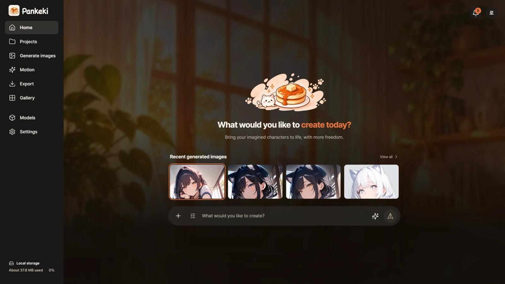

# Pankeki

**AI와 대화하며 캐릭터를 만들고, 로컬 이미지 도구로 다듬는 제작 스튜디오입니다.** 아이디어로 후보를 생성하고, 이미지를 눌러 수정하고, 선택한 작업을 프로젝트로 관리합니다. 자체 2D 리깅·동작 편집으로 이어가거나 Blender 구도를 이용한 로컬 영상 생성을 실험할 수 있습니다.

[English](README.md) · [macOS 안내](README.macos.ko.md) · [Windows 안내(시험)](README.windows.ko.md)

주 UI 언어는 한국어입니다. Comfy.org Open Source Higgsfield 챌린지를 목표로 개발하고 있습니다.



*Pankeki 홈 화면 — 2026년 10월 30일 사용자 제공 이미지.*

## 사용할 브랜치

| 브랜치 | 상태 |
| --- | --- |
| [mac-release-20261028](https://github.com/pullyo/pankeki/tree/mac-release-20261028) | 현재 macOS 데스크톱 앱과 로컬 엔진 연결입니다. 한 대의 Apple Silicon Mac에서 검증해 왔으며 폭넓은 하드웨어 호환성을 확인한 상태는 아닙니다. |
| `main` | **macOS와 Windows가 한 코드베이스입니다.** 2026-10-30에 macOS 앱(`mac-release-20261028`)과 Windows/CUDA 포팅(`windows-port-20261029`)을 합쳤습니다. 엔진·화면·데스크톱 앱은 같고, 설치·실행 스크립트와 몇 군데 OS 분기만 다릅니다. |
| [mac-release-20261028](https://github.com/pullyo/pankeki/tree/mac-release-20261028) | 대회 심사용 고정본(커밋 `016eb5e`)입니다. 더 갱신하지 않습니다. |
| [windows-port-20261029](https://github.com/pullyo/pankeki/tree/windows-port-20261029) | `main`에 합친 옛 Windows 포팅 브랜치입니다. 더 갱신하지 않습니다. |

## 작업 흐름

- **하나의 입력창:** 일반 대화·이미지 생성·수정 요청을 자동으로 연결합니다. 실제 선택한 AI/이미지 모델과 해상도, 진행·취소·오류 상태를 표시합니다. 완료 답변을 복사하고, 실패한 요청은 입력창으로 되돌려 검토한 뒤 직접 다시 보낼 수 있습니다.
- **이미지를 눌러 수정:** 결과를 클릭하면 오른쪽 편집기가 열립니다. 이미지 작업 버튼은 이미지와 함께 표시하고, 이미지를 열기 전에는 편집기를 펼치지 않습니다. 브러시 또는 업로드한 마스크로 수정할 영역을 지정합니다.
- **생성 기록과 프로젝트 분리:** 일반 생성 기록은 프로젝트 등록 없이 보관합니다. **새 프로젝트** 또는 **프로젝트로 저장**할 때 명시적으로 프로젝트를 등록합니다. 중앙 프로젝트 화면에서 여러 프로젝트를 찾아 전환하고 파일을 저장·다시 열며 보드 PNG를 출력할 수 있습니다. 파일 다운로드만으로 일반 생성 기록이 프로젝트로 바뀌지는 않습니다.
- **자체 2D 동작:** 준비한 PNG 부위·메시·표정·동작을 편집하고 pose PNG 또는 48프레임 ZIP을 출력합니다. Cubism 재생 및 Blender 영상과는 별도의 작업 경로입니다.

| 이미지 작업 | 로컬 엔진 |
| --- | --- |
| 캐릭터 생성·원본을 참고한 전체 생성 | ComfyUI의 SDXL 1.0 Base 또는 Animagine XL 4.0 Opt |
| 마스크 영역 재생성 | SDXL Base 조건부 정보를 사용하는 전용 SDXL Inpainting 0.1 UNet |
| 색상만 변경 | 이미지 모델을 사용하지 않는 CPU 연산 |

마스크 합성은 마스크 밖 RGB와 원본 alpha를 보존하도록 검사합니다. 이 불변식과 마스크 안에서 요청한 의미적 수정이 성공했는지는 별개입니다. 얼굴·손·의상·캐릭터 일관성은 결과를 직접 확인해야 합니다.

## 로컬 처리와 외부 AI 전송 범위

이미지 추론은 로컬 ComfyUI, 단순 색상 변경은 CPU에서 처리합니다. 데스크톱 대화는 별도로 설치한 **Codex CLI** 또는 **Claude Code CLI**와 본인 계정 로그인을 사용합니다. 대화 텍스트, 선택한 원본 이미지 문맥, 생성 결과 미리보기, 도구 요청·결과가 선택한 AI 공급자로 전송될 수 있습니다. 따라서 **대화까지 완전한 오프라인 작업은 아닙니다.** 프로젝트 저장소와 모델 가중치는 로컬에 유지합니다. 지원하는 CLI 로그인 흐름에 앱 전용 API 키를 별도로 요구하지 않습니다.

로컬 서비스는 Pankeki `127.0.0.1:8190`, ComfyUI `127.0.0.1:8188`을 사용합니다. 인터넷에 직접 공개하는 서버 배포 안내가 아닙니다. 선택 기능인 MCP 도구는 같은 로컬 이미지 API를 에이전트에 연결합니다. 별도 준비는 [도구 안내](plugins/pankeki-local/README.ko.md)를 확인하세요.

## macOS에서 시작

Apple Silicon Mac, Python 3.12 또는 3.13, `curl`이 필요합니다. 데스크톱 앱에는 Node.js 24와 npm도 필요합니다. SDXL 1024×1024 작업은 메모리 32 GB와 여유 디스크 약 30 GB를 시작 기준으로 권장합니다. 영상에는 별도 도구·가중치·메모리·시간이 더 필요합니다.

```bash
git clone https://github.com/pullyo/pankeki.git
cd pankeki
bash scripts/setup-macos.sh --models
# 데스크톱 이미지 도구용 전용 MCP 환경 준비
.venv-macos/bin/python plugins/pankeki-local/scripts/configure_paths.py
.venv-macos/bin/python plugins/pankeki-local/scripts/setup_runtime.py
```

설치는 고정 ComfyUI와 제품 모델 3종(합계 약 19 GB)을 내려받고 모델 SHA256을 확인합니다. 기존 모델이 해시와 다르면 보존하고 오류를 표시합니다. 옵션 없이 실행하면 편집 환경, `--generation`은 모델 없는 ComfyUI 환경, `--sdxl`은 SDXL Base만 준비합니다. 최초 설치에는 네트워크가 필요합니다.

실행 환경이 이미 준비되어 있다면 데스크톱 앱을 엽니다.

```bash
cd desktop
npm ci
npm start
```

**새 clone의 첫 실행:** 현재 Mac 설치 스크립트는 생성 설정 파일 2개를 아직 만들지 않습니다. 별도 터미널의 프로젝트 루트에서 `./Pankeki.command --no-browser`를 실행해 켜 둔 뒤 위 데스크톱 명령을 사용하세요. 브라우저를 열지 않고 설정·서버를 준비하며 앱은 이 서버를 재사용합니다. 종료할 때 해당 터미널에서 Control+C를 누릅니다. 설정이 준비된 이후에는 데스크톱 앱이 서버를 직접 시작할 수 있습니다.

`configure_paths.py`는 현재 폴더의 MCP 절대경로 선언을 만듭니다. `setup_runtime.py`는 이를 읽고 `.venv-macos`를 기반으로 전용 Python 환경을 생성해 `server/requirements.txt` 설치와 `pip check`를 수행합니다. 글로벌 플러그인 등록이나 CLI 계정 설정 변경은 필요하지 않습니다. 데스크톱 bridge가 이 환경을 직접 사용합니다. 폴더를 옮기면 경로 선언을 갱신하며, 이동한 가상환경은 재생성이 필요할 수 있습니다.

앱에는 외부 프로젝트 폴더와 Python·ComfyUI·모델·별도 Codex/Claude CLI가 필요합니다. 상세 설치·패키징은 [macOS 안내](README.macos.ko.md)를 확인하세요.

**브라우저 선택 경로:** `./Pankeki.command`는 공유 이미지·편집 UI를 브라우저에 열고, `./Pankeki.command --editor-only`는 생성 서버 없이 실행합니다. 네이티브 Codex/Claude 대화 bridge는 데스크톱 앱의 기능이며 브라우저 경로가 이를 대신하지 않습니다.

## Windows

`main`을 받은 뒤 위 macOS 명령 대신 [Windows 설치 안내](README.windows.ko.md)를 따르세요. Windows 10/11 x64, Python 3.12/3.13, NVIDIA CUDA를 대상으로 합니다. 브라우저 편집 전용 경로와 명시적인 CPU 생성 옵션도 있습니다. 데스크톱 앱에는 생성 환경이 필요하며 엔진·모델·CLI는 외부에 준비합니다. 교차 빌드 패키지는 무서명이라 SmartScreen 경고가 나올 수 있습니다. **실제 Windows 검증 기록은 아직 없습니다.**

## 실험 기능과 제한

- **Blender·로컬 영상은 macOS 실험 기능입니다.** 씬의 가이드를 렌더해 별도 로컬 영상 런타임에 전달합니다. 호환 Blender·영상 도구·가중치는 기본 이미지 설치에 포함하지 않습니다. 긴 춤 영상, 원화 일관성, 출력 품질, 생성 속도를 보장하지 않습니다. Windows에서는 비활성입니다.
- **Apple Vision 배경 분리는 macOS 전용입니다.** 선택 helper에 Apple 개발 도구가 필요하며 Windows에서는 비활성입니다.
- **Live2D/Cubism 재생은 비활성입니다.** 모델 폴더의 경로·참조 검사는 가능하지만 공식 Core/Framework SDK는 포함하지 않습니다. `.moc3` 재생과 자체 리깅 도구의 Cubism 모델 출력은 지원하지 않습니다.
- 자동 검사는 통제된 fixture와 가짜 서비스 응답을 사용합니다. 테스트 통과나 앱 패키지 생성은 실제 GPU 추론·이미지 품질·네이티브 호환성 검증을 대신하지 않습니다. 일반적인 성능 보장도 없습니다.

## 개발·라이선스

현재 브랜치의 `pankeki/`는 로컬 서버·엔진, `web/`은 공유 UI, `desktop/`은 Electron·CLI 연결입니다. 프론트엔드를 바꾸면 해당 브랜치의 프로젝트 Python으로 `web/build.py`를 실행합니다. 과거 체크포인트·디자인 문서는 역사적 기록으로 보존하며 현재 기능표로 사용하지 않습니다.

자체 코드는 [MIT](LICENSE)입니다. ComfyUI·모델·폰트·아이콘의 별도 조건은 [THIRD_PARTY.md](THIRD_PARTY.md)에 있습니다. 모델 이용 조건은 소프트웨어 라이선스와 별도로 해당 구성요소의 원문 조건을 확인하세요.
