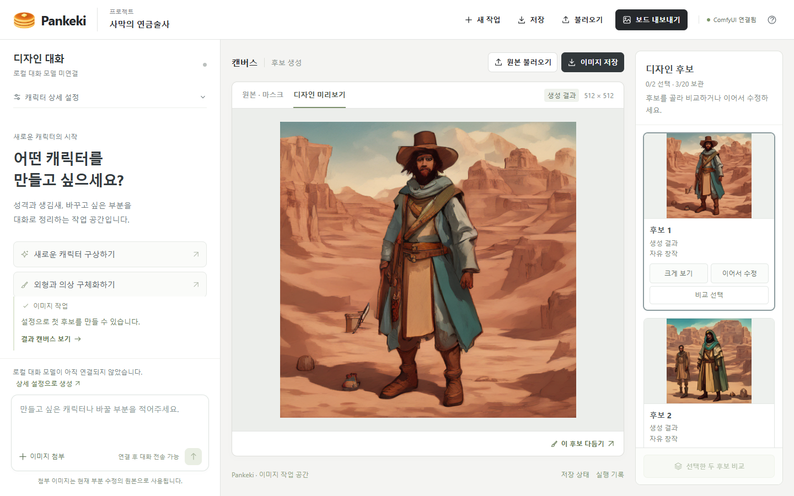

# Pankeki

**대화와 이미지 작업을 연결하는 ComfyUI 기반 캐릭터 디자인 작업실.**

게임·웹툰·소설·버추얼 캐릭터·마스코트 등 여러 용도의 캐릭터 아이디어를 정리하고, 후보를 만들고 비교하며 선택한 영역을 다듬는 로컬 웹앱입니다.

> **개발 중인 공개 스냅샷입니다.** 이미지 생성·부분 수정·프로젝트 저장은 구현되어 있습니다. 채팅 중심 화면은 있으나 로컬 대화 모델과 MoE 연결은 아직 완료되지 않았습니다. 생성 품질과 편집 지시 준수도 개선 중입니다.



위 이미지는 실제 앱 화면입니다. 화면의 생성 결과는 품질을 보장하는 완성 원화가 아니며, 대화 모델 미연결 상태가 표시되어 있습니다.

## 구현 범위

| 기능 | 현재 상태 |
| --- | --- |
| 캐릭터 소개·외형·색상·용도 설정 | 구현 |
| ComfyUI로 후보 생성 및 비교 | 구현 |
| 원본 이미지와 마스크를 이용한 부분 수정 | 구현, 의미·재질·인물 유지 정확도 개선 중 |
| 프로젝트 JSON 저장·불러오기, 브라우저 자동 저장 | 구현 |
| 후보와 설정을 이미지 보드로 내보내기 | 구현 |
| 채팅 중심 작업 화면 | 구현 |
| 로컬 LLM/MoE와 실제 대화 | 미연결 |
| 공식 Comfy SDK를 통한 실행 경로 | 선택 연결 구현, 기존 개발 환경에서 실생성 확인 |
| ROI·쿼드트리·LOD·타일 계획 | 실험 코드, 실제 확산 모델 가속 효과는 미확인 |

## 실행 준비

현재 안내는 Windows와 Python 3.12 기준입니다. 별도로 실행 중인 [ComfyUI](https://github.com/Comfy-Org/ComfyUI)와 호환 체크포인트가 필요합니다. GPU 드라이버·PyTorch·ComfyUI·모델 가중치는 이 저장소에 포함하지 않습니다.

현재 기본 생성 설정은 SD Turbo 실험에 맞춰져 있습니다. 다른 모델에는 해당 모델에 맞는 샘플러·스텝·CFG·해상도 설정이 필요합니다. SDXL 비교 실험은 수행했으나 이 스냅샷의 기본 모델 선택과 품질 개선 작업은 완료되지 않았습니다.

```powershell
git clone https://github.com/pullyo/pankeki.git
cd pankeki
py -3.12 -m venv .venv
.\.venv\Scripts\python.exe -m pip install -r requirements-lock.txt
.\.venv\Scripts\python.exe web\build.py
.\.venv\Scripts\python.exe -m pankeki serve --port 8190 --comfy-url http://127.0.0.1:8188 --config examples/direct-config.json
```

브라우저에서 **http://127.0.0.1:8190**을 엽니다. 위 예시는 ComfyUI에 `sd_turbo.safetensors`가 준비되어 있다고 가정합니다. 파일명이 다르면 `examples/direct-config.json`의 `model_name`을 수정하세요. 체크포인트는 ComfyUI의 `models/checkpoints`에서 관리하며 모델 이용 조건은 별도 확인해야 합니다.

`web/index.html`은 소스에서 생성하는 산출물입니다. 화면을 수정한 뒤에도 `python web/build.py`를 실행하세요. 외부 웹 폰트나 아이콘 패키지가 없어도 시스템 글꼴과 기본 아이콘으로 빌드합니다.

### 선택: Comfy SDK 연결

기본 안내는 직접 연결입니다. SDK 경로를 시험하려면 ComfyUI를 8188에서 실행한 후 다음을 별도 터미널에서 실행합니다.

```powershell
py -3.12 -m venv integrations\comfy-sdk\.venv
.\integrations\comfy-sdk\.venv\Scripts\python.exe -m pip install -r integrations\comfy-sdk\requirements.lock.txt
.\integrations\comfy-sdk\start-proxy.ps1
```

프록시는 로컬 8189 포트를 사용합니다. 이어 앱을 `--config examples/sdk-config.json`으로 실행합니다. 모델 파일명은 동일하게 실제 설치 상태에 맞춰 수정합니다. 프록시가 준비되지 않았으면 SDK 연결은 동작하지 않습니다.

## 구조

```text
pankeki/                 로컬 서버, 실행 관리, ComfyUI 연결, 마스크·캐시·영역 계획
web/src/                 화면 템플릿, 스타일, 앱 동작, 캐릭터 용도 설정
web/build.py             단일 HTML 빌드
tests/                   Python 검증
web/tests/               캐릭터 프로필 검증
scripts/test_ui_state.cjs 화면 상태 검증
examples/                API 워크플로와 실행 설정 예시
integrations/github/     외부 워크플로 연결 코드와 참조 버전 기록
integrations/comfy-sdk/  공식 SDK/프록시 연결 코드와 라이선스
```

## 검증

```powershell
.\.venv\Scripts\python.exe -m unittest discover -s tests
.\.venv\Scripts\python.exe -m unittest discover -s integrations/github -p test_workflow_bridge.py
.\integrations\comfy-sdk\.venv\Scripts\python.exe -m unittest discover -s integrations/comfy-sdk -p test_bridge.py
node --test web/tests/profiles.test.cjs scripts/test_ui_state.cjs
```

Node.js는 위 화면 상태 검증에 사용하며 웹앱 실행 자체에는 필요하지 않습니다. 자동 검증 통과는 생성 이미지의 미적 품질이나 지시 준수를 보장하지 않습니다. 새 PC에서의 전체 설치 재현성은 추가 확인이 필요합니다.

## 현재 한계와 다음 작업

- **이미지 품질:** 불필요한 인물·형태 왜곡·소품 및 재질 지시 불이행 사례가 있습니다. 현재 결과를 완성 원화 품질로 보장하지 않습니다. 모델별 적정 설정과 고정 입력 비교가 우선입니다.
- **대화:** 연결되지 않은 모델의 응답을 표시하지 않습니다. 로컬 MoE 후보는 연구·검증 단계이며 모델 가중치와 대화 기능은 포함하지 않습니다.
- **부분 수정:** 마스크 밖 원본 보존과 마스크 안 의미적 정확도는 별도 기준입니다. 밖을 보존해도 요청한 수정이 성공한 것은 아닙니다.
- **캐시:** 정확한 완료 결과 재사용을 다루며 모델·환경 상태를 확인할 수 없는 서버에서는 캐시를 우회합니다. 임의로 관리 환경 표시를 켜면 안 됩니다.
- **최적화:** 화면 기술에서 착안한 영역·갱신 계획은 실험입니다. 모니터 로컬 디밍이나 OLED 제어가 이미지 모델 연산을 직접 줄이는 것은 아닙니다. 모델 내부 행렬곱을 사칙연산으로 치환해 자동으로 빨라진다고 주장하지 않습니다.
- **재현성:** 같은 모델·시드·해상도·샘플러로 속도, 메모리, 단일 인물 유지, 수정 지시 준수, 경계 품질을 함께 비교할 예정입니다. 속도만으로 품질 저하를 정당화하지 않습니다.

사용자 데이터, 실행 로그, 모델 가중치, 개인 환경 설정과 비공개 개발 대화는 공개본에서 제외했습니다. 인터넷에 서버를 직접 노출하는 배포 구성은 제공하지 않습니다.

## 라이선스와 출처

Pankeki 자체 소스 코드는 [MIT](LICENSE)로 공개합니다. 외부 프로젝트·모델·브랜드 이미지의 조건은 별도이며 [THIRD_PARTY.md](THIRD_PARTY.md)에 정리했습니다. SD Turbo를 사용하는 예시는 **Powered by Stability AI**입니다.
