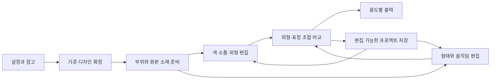

# Pankeki 공통 캐릭터 제작과 Live2D 기술 적용 기획안

2026년 10월 20일 · 아지 총괄 · 신규 기능 설계 제안

Pankeki의 목표는 설정과 그림을 바탕으로 캐릭터를 확정하고, 그 캐릭터의 부위·외형·표정·작은 움직임을 이어서 편집하는 작업실이다. 게임·웹툰·버튜버·마스코트는 공통 제작 문서를 사용하고, 마지막 출력과 후속 제작 단계에서 갈라진다. 분야를 하나로 제한하지 않는다.

첫 제품 목표는 **승인한 캐릭터의 원본 소재를 유지하면서 색·소품·표정을 수정하고, 같은 프로젝트에서 정지 이미지와 짧은 움직임을 출력하는 것**이다. 수상 경쟁력은 이 작업이 기존 방식보다 얼마나 빠르고 정확하며 다시 편집하기 쉬운지로 입증한다. 아래의 성능·사용성 수치는 검증 목표이며 측정 결과가 아니다.

## 최신 사용자 방향: 생성과 수정을 편하게

사용자는 2026-10-20에 캐릭터 생성과 수정의 편리함을 내세울 장점으로 만들도록 요청했다. 제품의 첫 약속은 **“상상한 캐릭터를 쉽게 만들고, 마음에 드는 모습은 유지하며 원하는 부분을 고친다”**로 정한다. 기능 수나 변형 엔진의 존재보다 사용자가 원하는 디자인에 도달하는 과정을 우선한다. 아래는 경험 설계 기준이며 새 기능의 구현 완료를 뜻하지 않는다.

| 사용자 경험 | 구체적인 제품 기준 | 현재 기반과 추가 과제 |
| --- | --- | --- |
| 쉽게 시작하기 | 짧은 설명·참고 그림·내 그림 중 하나로 시작한다. 모델명·시드·스텝은 기본 흐름에서 고를 필요가 없다. 필요한 정보가 없으면 간단히 보완한다 | 브리프·업로드·후보 생성 UI 기반이 있다. 새 모델의 앱 SDK 경로와 기본값은 비교 결과로 검증해야 한다 |
| 원하는 부분만 고치기 | 영역을 고른 뒤 “장갑만 청록색으로”처럼 요청한다. 단순 색 변경은 직접 조절, 새로운 재질·의상은 부분 생성으로 나눠 불필요한 추론을 줄인다 | 수동 마스크·원본 밖 합성 보존 기반이 있다. 직접 색 조절과 자연어 요청 연결은 추가 구현 대상이다 |
| 마음에 든 결과 지키기 | 변경 전후를 비교하고 적용·되돌리기를 명시한다. 미리보기와 실패 결과가 기준 원본을 덮지 않게 한다 | 후보 비교·선택 이력이 있다. 일관된 적용·되돌리기와 편집 상태 저장은 구체화가 필요하다 |
| 반복 작업 줄이기 | 같은 장갑을 다시 고칠 때 선택 영역과 설정을 재사용한다. 저장 후 다시 열어도 편집을 이어 간다 | version1 저장은 브리프·후보·선택 이력 중심이다. 마스크·이름 붙인 부위·편집 상태 영속화는 추가 개발 대상이다 |
| 다음 작업 알기 | 따뜻한 기존 UI에서 생성 → 비교 → 부분 수정 → 저장으로 이어 간다. 대화는 도움말·수정 제안으로 사용하고 실제 이미지 실행은 사용자가 명시한다 | 기존 화면을 재사용한다. Codex 실제 대화와 변경 제안 연결은 미구현이다 |

보존 약속의 범위는 명확히 한다. 정지 이미지에서 승인한 마스크 밖은 원본 합성으로 지키되, 마스크 안에 포함된 얼굴·머리·스타일의 동일성은 생성 모델이 자동 보장하지 않는다. 자연어만으로 완벽하게 부위를 찾거나 캐릭터 전체를 고정한다고 표시하지 않는다.

Live2D 원리의 부위·파라미터·짧은 움직임은 이 제작 경험을 확장한다. 주된 설명과 첫 시연은 쉬운 생성·안전한 수정·재개에 둔다. 기존 부위·리그 계획을 삭제하거나 완료로 바꾸지 않는다.

편리함은 다음 동일 과제로 검증한다. 측정 결과가 나오기 전에는 “몇 초 완성”, “누구나”, “캐릭터 완벽 유지” 같은 확정 문구를 쓰지 않는다.

- 처음 쓰는 사람이 짧은 설명이나 자기 그림에서 시작해 기준 캐릭터를 고르고 장갑색을 수정한 뒤 저장·재개한다.
- 첫 만족 결과까지의 시간, 수정 성공까지의 재시도 수, 사용자가 직접 한 조작 수, 도움 요청 횟수를 기록한다. 생성 대기·수동 보정·실패 시간도 포함한다.
- 수정 지시 준수와 마스크 밖 RGB·알파 보존을 따로 판정한다. 보존 성공만으로 의미 있는 수정 성공이라고 부르지 않는다.
- 실제 저장된 범위와 재개된 상태를 대조한다. 현재 version1에 없는 마스크·부위·대화 복원을 시연 문구로 약속하지 않는다.

## 제품 접근 방식

| 접근 | 이점 | 부담과 판단 |
| --- | --- | --- |
| **권장: AI 제작 보조와 편집 가능한 부위·파라미터 결합** | 생성한 디자인을 확정한 뒤에도 원본 소재로 수정·변형·출력을 이어 간다 | 부위 준비와 변형 데이터가 필요하다. 첫 범위를 제한해 전체 흐름을 완성한다 |
| 기존 생성·부분 수정·비교 기능 고도화 | 현재 코드 재사용이 크고 기본 품질 문제에 집중하기 쉽다 | 이 기능만으로 차별성을 설명하기 어렵다. 권장안의 기반으로 포함한다 |
| 전체 Cubism 편집기 수준의 자동 리깅 도구 | 큰 제작 범위를 다룰 수 있다 | 단일 이미지의 가려진 그림 복원, 메시, 다축 변형, 물리와 전용 형식까지 범위가 커진다. 이번 첫 완성 범위에서 제외한다 |

## 공통 제작 흐름

| 단계 | 사용자 조작 | 앱이 남기는 결과 | 제작 효과 |
| --- | --- | --- | --- |
| 1 설정과 참고 | 성격·실루엣·색·필수 소품을 적고 그림이나 참고를 넣는다 | 캐릭터 설정, 참고, 필수 조건 | 이후 결과를 판단할 기준이 생긴다 |
| 2 디자인 탐색 | 후보를 만들거나 자기 그림을 가져오고 기준 디자인을 확정한다 | 기준 원본과 설정의 같은 시점 스냅샷 | 다른 후보의 설정과 그림이 섞이지 않는다 |
| 3 부위 준비 | 장갑·눈·입 등을 선택하고 이름·앞뒤 순서·부모 부위를 정한다 | 재사용 마스크, 투명 부위 소재, 좌표와 계층 | 다음 수정 때 같은 부위를 다시 지정할 수 있다 |
| 4 외형 다듬기 | 색·위치·크기를 조절하거나 새 재질·의상 후보를 요청한다 | 조정값 또는 승인한 부위 소재의 새 버전 | 원본을 남기면서 변경할 수 있다 |
| 5 표정과 작은 움직임 | 눈·입의 기준 형태를 잡고 파라미터를 움직인다 | 메시, 기준 형태, 표정 프리셋, 짧은 동작 | 같은 그림을 이용해 중간 형태와 움직임을 만든다 |
| 6 비교와 확정 | 외형안·표정안을 같은 크기로 비교하고 선택한다 | 선택한 조합과 선택 이유 | 의상마다 표정을 새로 만드는 반복을 줄인다 |
| 7 출력과 재개 | 이미지·시트·부위 소재·프로젝트·동작을 저장한다 | 제작용 파일과 편집 가능한 원본 프로젝트 | 다른 용도로 출력하고 다음 작업을 이어 간다 |

## 시각 디자인 기준

2026년 10월 20일 사용자가 제공한 따뜻한 색감의 참고 화면을 최신 시각 기준으로 삼는다. 크림색 바탕, 따뜻한 흰색 패널, 살구색 선택 영역, 주황색 주요 조작, 짙은 갈색 글씨와 작은 팬케이크 로고를 사용한다. 작업 중인 캐릭터 그림과 마스크·색상환은 UI 색감과 구분한다. 화면 구조와 기능 범위는 유지한다.

참고 이미지에 보이는 유료 플랜·가상 모델·자동 인식을 구현 기능으로 추가하지 않는다. [수정한 전체 화면 7장과 색상 기준](design-walkthrough-warm-20261020/README.ko.md)은 디자인 시안이며 실제 앱 코드 적용 전이다.

## Live2D 핵심 원리의 구체적인 적용

Live2D는 파라미터의 키에 형태를 연결하고 그 사이를 보간한다. 디포머는 메시의 여러 정점을 함께 움직이며, 회전 디포머는 회전 변형을 다룬다. 이 원리를 Pankeki의 부위 편집 구조에 적용한다. [파라미터 공식 문서](https://docs.live2d.com/en/cubism-editor-manual/parameter/), [디포머 공식 문서](https://docs.live2d.com/en/cubism-editor-manual/deformer/)

| 핵심 원리 | Pankeki 기능 | 실제 조작과 구현 방식 |
| --- | --- | --- |
| 파츠 계층 | 캐릭터 부위 목록 | `캐릭터 → 머리 → 눈`처럼 부모와 앞뒤 순서를 정한다. 머리를 옮길 때 눈·입도 함께 움직인다. 선택 마스크와 실제로 분리한 소재를 다른 상태로 표시한다 |
| ArtMesh | 부위 형태 편집 | 투명 소재 위에 삼각형 메시와 조절점을 둔다. 같은 정점 연결과 UV를 유지한 채 형태를 조절한다. 소재의 경계가 바뀌면 변형의 유효성을 다시 확인한다 |
| 파라미터와 키폼 | 연속적인 형태 조절 | 예: 눈 뜨기 0~1에서 감음·중간·뜸 형태를 등록한다. 연결된 정점과 조절값을 보간한다. 서로 다른 생성 PNG 두 장을 섞는 방식은 사용하지 않는다 |
| 회전·워프 디포머 | 고개 기울기·호흡·소품 배치 | 부모 회전과 제한된 격자 변형으로 기존 소재를 움직인다. 큰 얼굴 방향 전환은 새로 드러나는 면이 필요하므로 후속 범위다 |
| 파라미터 프리셋 | 표정 저장과 재사용 | `놀람`을 눈·눈썹·입 조절값 묶음으로 저장한다. 사용자가 강도를 조절한다. 프리셋은 연결된 리그가 호환되는 경우에만 재사용한다 |
| 파라미터의 시간 변화 | 짧은 반복 동작 | 눈 깜빡임과 호흡을 시간 곡선으로 저장하고 재생한다. 첫 범위는 결정적인 반복 곡선이며 머리카락 물리 시뮬레이션은 후속이다 |

첫 변형 엔진은 공개된 원리를 참고한 Pankeki 자체의 제한된 2D 메시·파라미터 구조로 설계한다. 새로운 프레임마다 이미지 모델을 호출하지 않는다. 기존의 Comfy SDK는 새 그림이 필요한 작업을 맡는다. Cubism 내부 코드를 추출하거나 Core를 자체 구현했다고 주장하지 않는다.

설치된 Cubism Editor는 소재 준비와 변형 품질의 비교 도구로 활용한다. Cubism 모델의 직접 재생은 공식 SDK를 사용하는 별도 연동 경로로 둔다. Web Framework에는 Core가 포함되지 않으며, `.moc3` 등 임베드용 모델은 Editor의 내보내기 흐름에서 생성한다. 첫 버전이 `.cmo3`·`.moc3`를 생성하거나 VTube Studio에서 바로 실행된다고 표시하지 않는다. [공식 Framework](https://github.com/Live2D/CubismWebFramework), [Editor 내보내기](https://docs.live2d.com/en/cubism-editor-manual/export-moc3-motion3-files/)

## AI와 직접 편집의 역할

| 요청 종류 | 처리 | 결과를 확정하는 조건 |
| --- | --- | --- |
| 장갑을 청록색으로 조절 | 저장된 마스크 안에서 색상·채도·명도와 혼합 강도를 조절한다. 가능하면 기존 음영을 유지한다 | 지정 범위 밖 픽셀 보존, 대상색과 음영의 시각 확인. 금속 광택·반사까지 자동으로 분리된다고 가정하지 않는다 |
| 소품의 위치·크기 변경 | 분리한 소재를 변환한다 | 가려졌던 배경이 준비돼 있어야 이동을 허용한다. 준비되지 않으면 보완할 부분을 표시한다 |
| 눈 뜨기·입 벌림·호흡 | 등록된 형태와 변형값을 계산한다 | 부위 소재·리그·키폼이 준비된 파라미터만 활성화한다 |
| 새 의상·재질·그림 요소 | Comfy SDK로 선택 범위의 후보를 생성한다 | 원본과 비교 후 사람이 적용한다. 같은 인물·재질 준수를 자동 보장하지 않는다 |
| 가려진 소재 보완 | 필요한 빈 영역을 표시하고 부분 생성 또는 직접 그린 소재로 보완한다 | 분리된 상태와 움직이는 상태 모두에서 경계·구멍·겹침을 확인한다 |
| 자연어 요청 | 실제 연결된 모델이 명령 초안을 만든다. 도구와 채팅은 같은 명령 검사를 사용한다 | 대상 부위·변경값·유지 조건을 확인한 후 적용한다. 미연결 상태에서도 직접 도구 조작은 가능하다 |

잠금은 두 종류로 나눈다. 정지 원본의 부분 수정에서는 잠긴 픽셀과 마스크 밖을 보존한다. 형태 편집에서는 부위의 소재 변경·직접 변형을 잠그되, 부모와 함께 움직이는 관계를 별도로 표시한다. 움직이는 캐릭터의 화면 좌표에서 픽셀 불변을 약속하지 않는다.

## 한 번의 실제 제작 예시

사용자는 연금술사 그림을 생성하거나 가져와 기준으로 확정한다. 필수 조건은 청록 장갑, 붉은 가방, 기존 얼굴과 망토다.

1. 양손 장갑을 칠해 `장갑`으로 저장한다. 얼굴과 망토를 보호 영역으로 지정한다.
2. 색 조절 도구로 장갑만 청록색에 맞춘다. 조절할 때 새 이미지 생성 요청은 발생하지 않는다.
3. 가방을 별도 부위로 분리하고 앞뒤 순서를 확인한다. 가방이 가린 영역을 보완하기 전에는 다른 위치로 이동시키지 않는다.
4. 눈·입을 선택하고 분리 소재를 보정한다. 열린 입의 안쪽이나 감은 눈 그림이 없으면 준비가 필요한 항목으로 표시한다.
5. 눈 뜨기·입 벌림·호흡의 기준 형태를 잡고 슬라이더로 확인한다. 사용자는 필요한 조절점만 수정한다.
6. `기본·놀람·말하기`를 파라미터 조합으로 저장한다. 준비되지 않은 표정을 완성된 것으로 표시하지 않는다.
7. 장갑 색이 다른 두 외형안에 같은 표정 조합을 적용한다. 외형만 다른 경우 기존 리그를 재사용하고, 부위 경계가 바뀐 경우 재사용을 보류한다.
8. 표정 PNG, 표정 시트, 투명 부위 소재, 짧은 PNG 연속 프레임, 편집 가능한 프로젝트를 출력한다. 다시 열면 마스크·소재·조절값·선택 조합이 복원된다.

## 화면과 대화의 구성

이 구성은 기능을 설명하기 위한 화면 구조안이다. 앞서 만든 세 시안 중 하나를 최종 시각 디자인으로 확정한 것은 아니다.

상단에는 프로젝트 이름·저장 상태와 `디자인 / 부위 / 표정·동작 / 출력` 단계를 둔다. 단계 전환은 같은 문서의 보기 전환이며 부위와 설정을 복제하지 않는다.

왼쪽에는 부위 계층과 외형안, 중앙에는 큰 캔버스, 오른쪽에는 현재 선택에 필요한 조절만 둔다. 눈을 고르면 눈 뜨기와 기준 형태, 장갑을 고르면 색·소재·잠금이 나온다. 기본 화면에서 모든 설정을 한꺼번에 펼치지 않는다.

하단의 대화는 주 입력 경로로 유지하고 접을 수 있게 한다. `장갑만 청록으로, 놀람을 약하게`라는 요청은 대상·색 조절값·표정값을 담은 실행 카드로 정리한다. 모델이 준비되지 않으면 미연결을 표시하며, 작동하지 않는 전송이나 가짜 응답을 넣지 않는다. 동작 단계에서만 아래 시간 곡선을 펼친다.

키보드와 숫자 입력으로도 파라미터를 조절할 수 있게 한다. 잠금·선택·오류를 색만으로 구분하지 않으며, 실행 취소 후 초점과 선택 부위를 복원한다. 모바일은 보기·검토·간단 조절을 우선하고 정밀 메시 편집은 데스크톱을 첫 검증 대상으로 삼는다.

## 경쟁력을 만들고 입증하는 방법

Live2D는 정교한 변형을, Krita AI Diffusion은 생성 결과의 미리보기와 레이어 적용을, Adobe Character Animator는 캐릭터 퍼펫 제작과 연기를 이미 제공한다. 따라서 움직임·레이어·AI가 있다는 이유로 새롭다고 주장하지 않는다. [Krita 공식 가이드](https://docs.interstice.cloud/basics/), [Adobe 공식 개요](https://helpx.adobe.com/adobe-character-animator/desktop/introduction/overview.html)

차별화 가설은 **생성한 캐릭터를 편집 가능한 부위로 전환하고, 승인한 소재와 변형을 재사용해 외형안·표정·출력을 한 문서에서 이어 만드는 과정**이다. 숙련자의 정교한 전용 작업을 모두 대체한다는 목표는 두지 않는다.

| 경쟁력 가설 | 사용자가 얻는 효과 | 입증할 과제와 목표 |
| --- | --- | --- |
| 정확한 국소 수정 | 얼굴과 다른 부위를 다시 고치는 부담 감소 | 정지 원본의 색 조절에서 마스크 밖 RGB 오차 0. 대상색·음영은 사람이 평가한다 |
| 한 번 준비한 부위와 리그 재사용 | 외형안마다 같은 준비를 반복하는 부담 감소 | 같은 부위 경계의 색상안 3개에 표정 3개를 적용한다. 재사용 과정의 신규 추론 요청 0회 |
| 표정과 결과물의 연속성 | 만든 그림을 실제 콘텐츠에 사용 | 서로 다른 사용 목적의 창작자 3~5명이 표정 이미지와 짧은 동작을 출력하고 자기 작업에 쓸 수 있는지 평가한다 |
| 편집 재개 | 프로그램을 닫은 뒤 작업을 잃지 않음 | 저장·복원 후 부위·설정·파라미터·정지 렌더 결과가 같고 동일 작업을 계속한다 |
| 제작 시간 절감 | 반복 수정 비용 감소 | 같은 과제를 참가자가 쓰던 도구와 Pankeki로 수행한다. 작업 순서를 나누고 준비·보정·실패 시간을 포함한다. 중앙 작업시간 30% 단축을 목표로 삼는다 |

3~5명 검증은 초기 문제 발견과 방향 판단을 위한 것이다. 시장 전체 수요나 수상 가능성을 통계로 환산하지 않는다. 원본이 바뀌어도 모델이 같은 인물을 자동 보장한다는 주장을 피하고, 소재를 재사용한 범위와 AI가 다시 그린 범위를 화면과 데모에서 구분한다.

## 첫 완성 범위와 개발 순서

첫 시연 과제는 하나의 정면 상반신 캐릭터에서 외형 조절과 눈·입·호흡을 끝까지 만드는 것이다. 이는 입력과 변형 난도를 관리하기 위한 시연 범위이며, 제품의 사용 분야를 제한하지 않는다. 제어가 적은 동물·사물 마스코트는 수동 부위·파라미터 지정으로 같은 문서를 사용한다. 사람 얼굴용 자동 기준점을 모든 캐릭터에 적용하지 않는다.

| 단계 | 완성할 기능 | 다음 단계로 넘어갈 기준 |
| --- | --- | --- |
| 1 편집 가능한 원본 | 기준 원본, 이름 붙인 마스크, 보호 범위, 색 조절, 실행 취소, 저장·복원 | 다른 원본에 마스크가 잘못 적용되지 않고 보호 범위가 지켜진다 |
| 2 부위와 연속 변형 | 투명 PNG 부위 가져오기·수동 분리, 앞뒤 계층, 메시와 조절점, 눈·입·호흡 기준 형태 | 준비한 소재로 실제 중간 형태를 계산하고 새 추론 없이 조절한다. 메시 설정과 가려진 그림 보완의 수동 작업을 명시한다 |
| 3 조합과 제작용 출력 | 외형안·표정 프리셋 조합, 비교, 표정 시트·부위 PNG·PNG 연속 프레임 출력 | 같은 문서에서 출력하고 다시 열어 수정한다. 프레임 크기·알파·순서가 명세와 같다 |
| 4 AI 준비 보조 | 부위 선택 제안, 가려진 부분 후보 생성, 자연어 명령 연결 | 잘못된 제안의 보정·거절이 가능하고, 새 소재 적용 시 기존 리그 호환 여부를 확인한다 |

첫 부위 모델은 1024px 작업 캔버스의 정면 상반신, 최대 16개 부위와 3개 기본 파라미터를 검증 목표로 삼는다. 첫 동작은 2초·24fps의 48프레임이다. 작업 중 미리보기는 해당 장비에서 30fps 이상, 조절 입력의 화면 반영은 100ms 이내를 목표로 측정한다. 더 큰 그림과 부위 수의 지원은 메모리·저장·렌더 측정 후 확장한다.

마감 전 1~3단계를 완성할 수 있는지는 2단계의 작은 기술 검증으로 먼저 판정한다. 새 변형 하위 시스템과 소재 준비가 주요 위험이므로 1단계만 완성했을 때 Live2D 핵심 적용이 끝났다고 발표하지 않는다. 4단계 전체를 제출 선행 조건으로 삼지 않는다. 개발 소요일은 기술 검증 후 담당별로 산정한다.

첫 범위 이후에는 큰 얼굴 방향 전환, 전신 포즈, 자동 파츠 분리·리깅, 머리카락 물리, 실시간 얼굴 추적, Cubism 정식 연동과 전용 프로젝트 출력, PSD 입출력, 동영상 인코딩을 각각 독립 과제로 검토한다. 현재 PNG 연속 프레임을 바로 사용 가능한 버튜버 추적 모델로 표현하지 않는다.

## 데이터와 구현 구조

| 데이터 | 핵심 내용과 규칙 |
| --- | --- |
| Character | 기준 원본 버전, 설정, 필수 특징, 승인한 외형안 |
| Asset | 내용 해시로 중복 제거한 이미지·마스크. 원본 해상도·알파·좌표계를 기록한다 |
| Part | 부모 부위, 소재·마스크 참조, 기준 좌표·앞뒤 순서, 소재 잠금·변형 잠금 |
| Rig | 기준 메시·UV·삼각형 연결, 부모 디포머, 구성 해시. 마스크만 등록한 상태와 구분한다 |
| Parameter | 범위·기본값·연속 조절값, 대상별 기준 형태와 리그 해시. 값은 범위 안으로 제한한다 |
| Variant | 선택형 소재·색 조정값. 가죽·금속 같은 범주형 후보를 연속 보간하지 않는다 |
| Motion | 파라미터의 시간 곡선과 반복 구간. 전체 프레임 이미지를 프로젝트에 중복 저장하지 않는다 |
| Command | 대상 문서·원본·리그 버전, 변경 내용과 취소 정보. 화면 조작과 대화가 같은 경로를 쓴다 |

기존 `profiles.js`의 version1은 `brief / versions / selectionHistory`만 허용하고 편집 마스크를 저장하지 않는다. 새 version2는 자산 참조와 부위·리그·조절값을 저장하며 version1 파일을 원본·후보만 있는 문서로 읽는다. version1에 알 수 없는 필드를 붙여 덮어쓰지 않는다. 기존 파일은 유지하고 새 형식으로 저장한다. 현재 64MiB 상한은 자산 중복 제거와 저장 예상 용량 표시를 함께 적용하며, 초과하면 내용을 버리지 않고 저장을 중단해 안내한다.

기존 합성 코드는 정지 이미지의 RGB를 마스크 밖에서 보존한다. 새 투명 부위 소재는 RGBA 처리와 알파 검증을 추가해야 하며 기존 RGB 함수를 그대로 사용해 투명도를 잃게 하지 않는다. 부위 편집 좌표는 소재 좌표에 저장하고, 화면 변환 좌표와 분리한다.

요청은 원본·마스크·모델·워크플로의 버전에 연결한다. 생성 중 다른 캐릭터나 부위로 이동해도 늦은 결과가 현재 문서를 덮지 않게 한다. 소재의 실루엣이나 메시 구성이 바뀌면 연결된 기준 형태와 동작을 호환 확인 전 비활성화하고 원래 버전은 남긴다.

브라우저의 2D 메시 렌더러가 편집·미리보기를 맡고, 기존 Python·Pillow 경로가 정지 이미지 처리와 자산·출력을 맡는다. Comfy SDK는 새 소재 생성에 사용한다. 8GB GPU 환경에서는 대화 모델과 이미지 모델의 동시 상주를 전제하지 않는다. 파라미터 조절에는 생성 모델이 필요하지 않으며, 실제 추론 작업은 자원 상태에 맞춰 순서를 제어한다.

## 역할 분담과 검증

아래는 기존 팀의 역할 분담안이다. 이 문서 작성으로 새 개발 작업이 배정되거나 구현이 시작된 것은 아니다.

| 담당 | 맡을 결과 |
| --- | --- |
| 아지 총괄 | 공통 문서·명령 계약, 단계별 수용 기준, 통합과 시연의 주장 범위 |
| 제품 기획·사용자 리서치 | 공통 제작 과제, 용도별 출력 요구, 실제 창작자의 비교 사용 검증 |
| 기술 리서치 | 메시·키폼 계산의 작은 기술 검증, 부위 준비 난도, Cubism과 품질 비교 |
| 기능·이미지 품질 | RGBA 부위 처리, 보호 범위·색 조절, AI 후보와 가려진 영역 보완, 출력 경로 |
| 프론트엔드 구현 | 문서 version2, 부위·리그 상태, 렌더러, 파라미터·실행 취소, 늦은 응답 차단 |
| 디자인·사용성 | 선택·잠금·준비 상태, 맥락에 따른 조절 패널, 대화와 직접 조작 연결, 키보드 흐름 |
| 환경·회귀검증 | 기존 프로젝트 호환, 저장·복원, 픽셀·알파, 리그 무효화, 자원과 성능 검증 |
| 출시·제출 준비 | 실제 입력부터 내보내기까지의 시연, 설치 재현, OSS·워크플로·한계 안내 |

수용 검증은 정지 원본 편집의 보호 범위, 알파와 앞뒤 합성, 실제 중간 형태 계산, 서로 다른 리그의 잘못된 재사용 방지, 저장·복원, 생성 없이 조절·출력되는 경로를 포함한다. 미리 만든 영상 재생이나 이미지 교체를 연속 메시 변형의 검증으로 사용하지 않는다.

## 대회에서 보여줄 장면

공식 공고는 Best Overall과 Most Innovative를 구분하고, 실제 작동과 구현 설명을 강조한다. 제출 마감은 10월 30일 09시 PT로 안내돼 있다. Pankeki는 Comfy SDK로 생성·보완한 소재가 실제 편집 문서와 출력까지 이어지는 장면을 보여준다. 새로움을 설명할 근거는 기능 이름이 아니라 준비·수정·재사용에 드는 시간과 성공률이다. [공식 공고](https://comfy.org/open-source-higgsfield/)

2분 시연은 원본과 준비 상태 공개 → 장갑만 색 조절 → 실제 눈·입 파라미터 조절 → 외형안에 표정 재사용 → 출력과 프로젝트 재개 순서로 구성한다. AI 생성 대기나 수동 보정을 편집으로 생략하면 표시한다. 사전 리깅한 소재를 사용한 구간도 드러내며, 단일 PNG에서 전부 자동 완성했다고 소개하지 않는다.

현재 기반은 후보 생성·비교, 수동 마스크 수정, 원본 보존 합성, 공식 SDK 연결과 프로젝트 version1이다. 이름 붙인 부위 영속화, RGBA 파츠 편집, 메시·키폼·동작, 새 저장 형식은 추가 개발 대상이다. 이 기획안의 다음 판단은 **권장한 공통 문서와 편집 구조의 채택 여부**이며, 이후 작은 기술 검증과 구현 계획으로 구체화한다.
