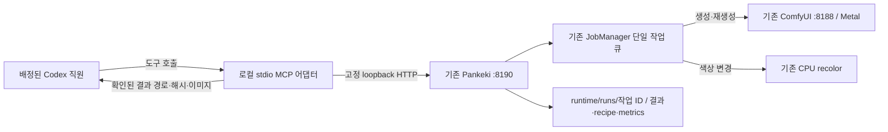

# Pankeki 로컬 도구 플러그인 타당성 검토

2026-10-23 KST · Pankeki Mac 출시 엔지니어.
대상: `/Volumes/Samsung 970 EVO Plus/V/restored-20261020/Pankeki`.

## 판정과 이번 검토 범위

**구조적으로 가능하다. 기존 Pankeki HTTP API를 감싸는 별도 Python stdio MCP 어댑터를 먼저 검증하고, 같은 어댑터와 사용 지침을 로컬 플러그인으로 묶는 구성이 적합하다.** 현재 Mac 앱·로컬 파일·ComfyUI·Metal 실행 경로를 유지한다. 제품 소스를 바꾸지 않고 생성/부분수정의 기존 작업 API를 재사용할 수 있다.

이는 설계 타당성 판정이다. MCP 서버·플러그인을 생성/설치/실행하거나 Codex 설정을 변경하지 않았다. 모델 다운로드·GPU 추론·POST 요청·브라우저 조작·외부 게시·새 채팅 생성도 하지 않았다. 이번 요청에서 새로 작성한 산출물은 이 문서 한 개다. 앞선 출처/중단 운영 정정과 구분한다.

기존 사람형 소재는 총괄이 역할 정정 전에 **Codex image_gen**으로 만든 외부 초안이며 `imported-external-art technical validation`으로 분류한다. 사용자 무릎 품질 이의에 따른 **전신 미술 최종 수용 미완료·완성 승격/최종 패키징 중단**은 그대로다. 새 도구가 향후 Pankeki를 호출할 수 있게 되더라도 기존 소재를 앱 자체 제작으로 소급 표시하지 않는다. 이 설계 검토는 제작/패키징 재개 지시가 아니다.

## 실제로 확인한 현재 상태

2026-10-23 **20:36:15 KST**의 읽기 전용 API 스냅샷이다. 실행 상태는 바뀔 수 있으므로 설치/실행 검증 시 다시 확인한다.

| 확인 대상 | 관측 결과와 한계 |
|---|---|
| `GET http://127.0.0.1:8190/api/health` | HTTP 200, `comfy=true`, `transport=direct`, `managed=false`, 기본 모델 `sdxl-base` / `sd_xl_base_1.0.safetensors`. ComfyUI 응답까지 연결됐다는 뜻이며 이번 추론 성공을 뜻하지 않는다. |
| `GET /api/models` | HTTP 200. SDXL Base `available=true`, SD Turbo `available=false`. 모델 목록의 available은 설정 경로의 파일 존재 판정이며 실제 바이트 무결성/미술 품질 판정이 아니다. |
| 현재 config | `transport=direct`, `managed_builtin_only=false`, `fingerprint_policy=strict`, 기본 `sdxl-base`. SDXL 파일 존재, SD Turbo 파일 없음. 모델 전체 SHA256는 이번에 재계산하지 않았다. |
| 제품 Python | `.venv-macos/bin/python`, Python 3.12.14. 설치 메타데이터에서 Torch 2.14.1, Pillow 12.3.0, NumPy 2.3.5 확인. Torch import·MPS 연산은 하지 않았다. |
| MCP 런타임 | 위 제품 가상환경에 `mcp` 배포판이 확인되지 않았다. `pankeki/`, `scripts/`에서 FastMCP/MCP 서버 선언을 찾지 못했다. 앱의 HTTP API가 현재 MCP 서버인 것은 아니다. |
| Codex 호스트 | `codex-cli 0.163.0-alpha.11.1`. `codex mcp --help`에 list/get/add/remove, `codex plugin --help`에 add/list/marketplace/remove가 있다. help/version만 실행했다. 실제 설치·호환성·도구 노출은 미검증이다. |

샌드박스 안의 첫 두 GET은 `Operation not permitted`로 차단됐다. 허용된 재시도에서 같은 두 상태/모델 GET만 성공했다. 이 일회성 읽기 허용을 미래 MCP 프로세스의 네트워크·파일 권한으로 간주하지 않는다. CLI help는 PATH 별칭 생성 권한 경고를 냈지만 종료 코드 0으로 출력됐다. 별칭·Codex 설정을 수정하지 않았다.

## 권장 연결 구조



어댑터는 Pankeki의 HTTP 클라이언트다. `Engine`이나 `JobManager`를 별도로 만들거나 ComfyUI `/prompt`를 직접 호출하지 않는다. 그러면 UI와 직원 도구가 같은 기존 큐·취소·마스크 합성·실행 증거를 사용한다. stdio 어댑터는 Codex가 시작/종료하되 기존 Pankeki/ComfyUI의 수명은 소유하지 않는다. 어댑터 종료로 앱을 끄거나 GPU 전체 interrupt를 보내지 않는다.

1차는 어댑터의 stdio 연결·무해한 상태 호출을 검증하는 단계다. 2차는 동일 어댑터에 사용 지침을 더한 로컬 플러그인이다. 둘은 같은 실행 경로이며 별도의 이미지 생성기를 만들지 않는다. 추가 웹 UI나 MCP App은 최소 범위에 필요하지 않다.

## 현재 API와 재사용 계약

| 기존 경로 | 실제 계약·어댑터가 지켜야 할 동작 |
|---|---|
| `GET /api/health`, `GET /api/models` | 연결 상태와 모델 목록 조회. health는 ComfyUI 실패 때도 HTTP 200 안에 `comfy=false`를 돌려주므로 본문을 검사한다. |
| `POST /api/jobs` | `{"session": "...", "request": {...}}` → HTTP 202, job_id/revision/state. mode는 `txt2img` 또는 `inpaint`. 실제 작업 제출이므로 설치·도구 발견 확인 중에는 호출하지 않는다. |
| `GET /api/jobs/{job_id}` | state, revision, is_current, prompt_id, error, result/metrics 조회. job_id는 소문자 16진수 32자다. |
| `POST /api/jobs/{job_id}/cancel` | JSON 객체 본문으로 논리적 취소 요청. GPU 연산 자체가 중단됐다고 보고하지 않는다. |
| `GET /api/results/{job_id}` | succeeded인 현재 메모리 작업의 PNG. `GET /api/previews/{job_id}`는 선택적인 진행 미리보기이며 최종 결과와 구분한다. |
| `runtime/runs/{job_id}/` | result.png, recipe.json, metrics.json 및 해당 작업의 workflow/dependencies/원본·mask 등. 종류·단계별 존재가 다르므로 모든 파일이 항상 있다고 가정하지 않는다. |
| `POST /api/cache/clear` | 현재 존재하지만 최소 도구에 노출하지 않는다. 생성 연결에 캐시 전체 삭제가 필요하지 않다. |

서버는 127.0.0.1에만 bind하고 Host/Origin·JSON Content-Type을 검사한다. 어댑터도 고정 `http://127.0.0.1:8190`에 정상 Host와 `application/json`을 사용한다. 비브라우저 클라이언트의 Origin 부재는 현재 허용된다. 사용자 입력으로 임의 URL·HTTP 메서드·헤더를 받거나 redirect/proxy로 우회하지 않는다.

이 guard는 로컬 호출자별 인증이 아니다. 현재 API에는 직원별 인증·작업 소유자 확인 토큰이 없다. 어댑터가 자기 접수 기록과 작업 ID를 연결해 잘못된 취소/결과 조회를 막아야 하며, 이를 악의적인 동일 macOS 사용자 프로세스까지 격리하는 장치로 표현하지 않는다. 별도 TCP MCP 포트는 열지 않는다.

## 최소 도구 6개 — 제안이며 아직 구현되지 않음

| 제안 도구 | 입력·출력 | 기존 기능 연결 |
|---|---|---|
| `pankeki_status` | 입력 없음. app/comfy 연결, 모델 목록, 생성 가능 조건·CPU 색상 변경 조건을 따로 반환 | GET health/models. 무해한 최초 검증 호출. |
| `pankeki_generate` | prompt, negative, 명시적 model_id, seed, 크기·steps/cfg/sampler/scheduler. job_id/revision 반환 | txt2img 작업 제출. 최초 기본 대상은 실제 available인 sdxl-base. |
| `pankeki_edit_region` | 허용된 source_path/mask_path, operation=regenerate 또는 recolor. 재생성은 prompt/model_id/denoise 등, 색상 변경은 target_color/source_color/color_tolerance/feather | inpaint 작업 제출. regenerate는 기존 SDXL 경로, recolor는 기존 CPU 경로. 둘을 모두 SDXL 추론이라고 부르지 않는다. |
| `pankeki_get_job` | 어댑터가 접수한 job_id. 상태·진행 정보·실패·관측 metrics 반환 | GET jobs. 생성 시간 동안 짧은 조회를 반복하며 긴 도구 호출 하나로 묶지 않는다. |
| `pankeki_cancel_job` | 어댑터 소유 job_id. canceling/canceled 및 기존 취소 의미 반환 | POST cancel. 결과가 폐기되더라도 이미 진행 중인 GPU 작업은 계속될 수 있다. |
| `pankeki_get_result` | 성공한 소유 job_id. 확인된 결과 PNG 경로·해시·치수·실행 기록 경로와 요약 반환 | GET results 및 허용된 해당 run 디렉터리 읽기. 호스트가 지원하면 제한 크기의 MCP 이미지 응답으로 표시하고 base64를 텍스트에 쏟지 않는다. |

마스크를 대신 그리는 도구, 원화 자동 파츠 분리·리깅·모션·프로젝트 저장 도구는 최소 범위에 넣지 않는다. 이번에 확인한 서버 API에는 해당 캐릭터 편집 기능의 HTTP 계약이 없다. UI에 기능이 있다는 사실을 원격 도구가 이미 호출할 수 있다는 뜻으로 쓰지 않는다.

source_path/mask_path는 명시적으로 허용된 프로젝트 입력 경로만 읽는다. 실경로를 정규화하고 symlink를 따라간 최종 경로가 허용 범위인지 확인한다. 모델 폴더·사용자 홈·Codex 설정·기존 직원 증거를 출력 대상으로 받지 않는다. 결과는 기존 backend가 생성한 `runtime/runs/{job_id}`만 참조한다. MVP에는 임의 파일 쓰기·shell 실행·모델 설치·서버 시작/재시작 도구가 없다.

## 요청·작업 수명에서 필요한 보완

- **모델/수치:** 모델은 매번 최신 models 응답의 available ID로 제한하고 자동으로 다른 체크포인트에 대체하지 않는다. prompt/negative는 각각 10,000자 이하, width/height는 64..2048의 8배수, steps 1..100, cfg 0..30, denoise .01..1, halo 0..512, feather 0..64다. sampler는 euler/euler_ancestral/dpmpp_2m, scheduler는 normal/simple/karras다. 이는 현재 backend 허용 범위이며 권장 품질값과 같지 않다. SDXL 기본값은 현재 API의 1024×1024·25 steps·cfg 6을 따른다.
- **seed:** backend 범위는 0..2^64-1이다. JSON/호스트의 큰 정수 정밀도 손실을 피하도록 MCP 입력에서는 10진 문자열로 받고 Python int로 검증/변환하는 안이 적합하다. 실제 실행된 seed를 접수/결과 기록에 남긴다.
- **이미지/마스크:** 두 입력을 PNG로 제한해 실디코드·동일 치수·최대 16,777,216픽셀을 확인한다. mask는 회색조의 검정 0=보존, 양수=수정 대상으로 전달한다. backend의 입력별 디코드 바이트 한도는 20 MiB지만 HTTP JSON 전체 한도는 32 MiB다. base64 팽창과 두 파일·프롬프트를 포함한 실제 UTF-8 요청 길이를 제출 전에 검사한다. 입력 파일 해시와 backend가 정규화해 저장한 original/mask PNG 해시는 별도로 기록한다.
- **직원/UI 동시 사용:** JobManager는 단일 worker이고 같은 session의 새 작업은 이전 미완료 작업을 취소한다. 어댑터가 앱 UI session을 재사용하지 않고, 기본적으로 각 독립 접수에 고유 session을 만든다. 같은 작업을 의도적으로 교체할 때만 연결한다. 여러 직원의 stdio 프로세스도 기존 서버 큐에 들어가며 자체 GPU 큐나 Engine을 추가하지 않는다. 채팅 신원은 호스트가 실제 전달/바인딩한 경우만 기록하고 임의로 추정하지 않는다.
- **실패/재시도:** queued/running/canceling과 succeeded/failed/canceled/uncertain을 그대로 구분한다. GET 상태 조회 실패는 제한적으로 다시 확인하되 POST 제출 응답 유실은 자동 재제출하지 않는다. 현재 앱 API에는 호출자 idempotency key·전체 작업 목록 API가 없어 job_id 수령 전 유실을 완전히 자동 조정할 수 없다. 로컬 접수 기록에 불확실성을 남기고 실행 담당이 확인한다. 엄격한 중복 방지가 필요하면 이후 별도 API 변경 배정이 필요하다.
- **재시작:** 작업 목록은 서버 메모리이며 최대 100개 기록에서 완료 작업이 정리될 수 있다. 앱 재시작 후 GET 404를 성공 결과 없음/실패로 단정하지 않는다. 이전에 검증해 기록한 run 경로·이미지 해시는 보존하고 재시작 전 증거라고 표시한다. 임의 job_id를 경로로 조합해 파일을 찾는 기능은 두지 않는다.
- **상태와 정책:** health/comfy 연결과 모델 available이 생성 권한이나 미술 수용을 뜻하지 않는다. 현재 managed=false이므로 strict라는 설정 이름만으로 체크포인트 전체 SHA나 exact cache가 검증됐다고 부르면 안 된다. backend는 unmanaged 경로에서 exact cache를 우회한다. CPU recolor·빈 마스크 복사·캐시 재사용을 새 SDXL 연산과 구분한다.

## 출처가 남는 결과 계약

플러그인의 가치는 직원이 **실제 Pankeki 경로로 작업하고 그 증거를 남기는 것**이다. 별도 run_id/job_id와 제출 시점, 정규화 요청·seed/model_id, 입력 원본/마스크 해시, backend recipe/metrics/workflow 경로·해시, 출력 파일 해시·치수·관측 완료 상태를 연결한다. 체크포인트는 선언된 manifest SHA와 실제 파일 검증 여부를 구분하고, 실제 계산하지 않은 hash는 verified로 쓰지 않는다.

model_calls는 제출 횟수이므로 실제 denoiser 실행의 단독 증거가 아니다. backend의 prompt_id·실행/캐시/복사/CPU 분류와 관측 가능한 노드 실행 정보를 함께 남긴다. CUDA 측정 필드가 비어 있는 Mac에서 임의 GPU 시간·VRAM 수치를 만들어 채우지 않는다. 기록이 부족하면 미확인으로 반환한다.

결과 출처는 최소한 다음처럼 나눈다. 새 텍스트 생성이 실제 SDXL 경로에서 실행됐을 때는 Pankeki/SDXL 생성, 외부 원화를 입력받아 수정했을 때는 **외부 원화 + Pankeki 부분수정**, recolor는 **Pankeki CPU 색상 변경**으로 표시한다. 이전 외부 PNG를 모델 도구가 한 번 읽거나 내보냈다고 전체 원화를 앱 제작으로 바꾸지 않는다. 도구 실행 성공과 원화·무릎·얼굴·리깅의 시각 품질 수용은 독립 판정이다.

## 로컬 패키지·실행/설치 설계

제안 소스 디렉터리는 `integrations/pankeki-local-plugin/`이며 이번에 만들지 않았다.

```text
pankeki-local-plugin/
  plugin.json
  mcp.json
  skills/pankeki-local/SKILL.md
  server/pankeki_mcp.py
  server/의존성 잠금 파일
```

`plugin.json`은 Agent Plugins 1.0의 이름/버전/표시 정보, `mcp.json`은 고정 위치의 stdio 서버 선언, skill은 실제 앱 선택·도구 순서·파일/결과 출처·품질 한계를 설명한다. portable plugin.json 안에 top-level mcpServers/skills를 넣지 않는다. 호스트가 `.codex-plugin/plugin.json`을 요구하는 경우만 호환 overlay의 이름·버전·표시를 동기화한다. 실제 지원은 설치 검증에서 확인한다.

어댑터는 기존 Python 계열을 활용하되 MCP SDK 의존성은 **플러그인 전용 가상환경**에 고정한다. 앱의 `.venv-macos`, requirements, Torch/ComfyUI 환경은 바꾸지 않는다. stdio command는 해당 환경의 검증된 Python 절대 경로, args는 실제 작성된 진입점의 절대 경로 목록, cwd는 플러그인 루트로 정한다. 경로의 공백은 shell 문자열 조합 없이 인자 배열로 처리한다. portable 선언의 `${PLUGIN_ROOT}` 치환도 실제 호스트에서 확인해야 한다. 현재 없는 진입점이나 설치 경로를 동작하는 구성으로 제시하지 않는다.

프로젝트 루트·고정 app URL·허용 입력 경로는 설치 시 정한 로컬 설정으로 바인딩하고 도구 호출자가 바꾸지 못하게 한다. 프로토콜 stdout에는 MCP 메시지만, 로그는 stderr로 보낸다. 이미지 생성 실행기와 다른 프로세스이므로 stdout에 Pankeki 시작 로그가 섞일 경로를 만들지 않는다.

현재 앱 연결이 끊기면 status에 원인을 반환하고 생성 요청을 내보내지 않는다. 기존 `scripts/run_macos.py`는 config/model-paths/process 기록을 쓰고 자식 서버를 시작하므로 무해한 설치 확인이나 자동 health 복구에 실행하면 안 된다. 실행이 필요한 후속 배정에서는 기존 실행 방식과 `--no-browser`를 활용할 수 있으나 중복 서버·포트 충돌·editor-only fallback을 확인해야 한다. 이 검토에서는 실행하지 않았다.

설치는 후속 배정 시 Codex의 지원되는 로컬 플로를 사용한다. 읽은 가이드의 `~/.agents/plugins/marketplace.json` 발견 규칙과 custom marketplace 등록을 확인하되 기존 항목을 보존한다. 현재 CLI에는 mcp/plugin 관리 명령이 있으므로 실제 add/marketplace 하위 help를 다시 읽어 그 버전에 맞춘다. 편집은 source 디렉터리에서 하고 host helper로 재설치/재로드하며 캐시를 직접 수정하지 않는다. 로컬 설치·stdout 연결이 확인되기 전 도구 사용 가능을 선언하지 않는다. 같은 서버를 직접 mcp 등록과 플러그인 등록으로 중복 활성화하지 않는다.

## 후속 검증의 완료 기준 — 이번에는 실행하지 않음

| 단계 | 통과 근거 | 현재 확인 |
|---|---|---|
| 앱 API 읽기 | 실제 health/models 200, comfy 값과 모델 availability를 분리해 기록 | 두 GET만 확인. 추론 미실행. |
| 패키지 정합성 | manifest/stdio 선언, 실제 진입점/가상환경, 공백 경로·오프라인 재현 가능한 의존성, 기존 설치 항목/캐시 보존 | 미구현·미설치. |
| stdio 연결 | 대상 Codex의 초기 연결·도구 발견, stdout 오염 없음, 제안 6개 도구의 schema·오류 응답 확인 | 미검증. |
| 무해한 도구 호출 | 호스트에 실제 나타난 pankeki_status로 같은 앱/모델 상태 확인. 앱 중단·SSD 미마운트·권한 부족에서 명확한 실패, 서버 자동 시작 없음 | 미검증. shell GET 성공을 MCP 호출 성공으로 대체하지 않음. |
| 파일/큐 경계 | 허용 밖/symlink·잘못된 크기·마스크 불일치·총 요청 초과 차단. 직원별 작업 분리, UI 작업의 뜻하지 않은 취소 없음 | 미검증. 관련 단위/통합 검사는 후속 구현에 맞춰 수행. |
| 실제 생성 | 별도 추론 배정에서 SDXL 1회 제출→상태→succeeded→PNG 실제 디코드·해시·recipe/metrics/실행 증거 연결 | 미실행. 모델 존재/health와 구분. |
| 실제 부분수정 | 승인된 원본/명시 마스크로 1회 실행. 결과·원본·mask 해시, alpha와 마스크 밖 픽셀 보존, 요청 반영/미술 품질을 별도로 판정 | 미실행. 기존 외부 원화의 완성/패키징 중단을 우회하지 않음. |
| 취소/유실/재연결 | 논리 취소·실행 지속 가능성, stale 결과 폐기, POST 중복 방지 한계, 앱/호스트 재시작 후 보존된 증거와 불확실성 확인 | 미검증. |
| 실제 로컬 플러그인 | 호스트 설치/로드 이후 이름·버전·도구가 발견되고 상태 및 배정된 실제 호출이 같은 경로로 동작 | 미검증. 필요 재연결 조건은 보고하고 새 채팅은 임의 생성하지 않음. |

연결/설치 수용은 위 대상 호스트의 실제 tool discovery와 harmless call까지 확인해야 한다. SDXL/부분수정 수용은 별도의 배정된 실제 실행 증거가 필요하다. 미술 완성·전신 무릎 수용·최종 패키지 수용은 이 기술 연결 검증으로 대체하지 않는다.

## 근거와 검토 한계

읽은 지침:

- `/Users/plant313/.codex/plugins/cache/openai-curated-remote/plugin-creator/0.1.28/skills/create-plugin/SKILL.md`: 직접 로컬 파일/프로세스/하드웨어 접근과 기존 소스가 필요한 경우 local plugin 선택·기존 앱 보존.
- 같은 디렉터리의 `references/local-plugins.md`: stdio mcp.json, stdout/stderr 분리, 실제 진입점, host 설치/도구 발견/무해 호출 검증.
- 같은 디렉터리의 `references/plugin-packages.md`: portable manifest/고정 mcp.json·skills 위치, 호환 overlay, 소스/캐시 분리. 이번에는 패키지 구성요소를 만들지 않았다.

읽기 전용으로 확인한 로컬 구현:

- `pankeki/server.py:34` Host/Origin/JSON guard, `:44` GET, `:80` POST, `:114` loopback bind.
- `pankeki/model_presets.py:7` 모델/기본값, `:55` availability가 파일 존재인지 확인.
- `pankeki/engine.py:56` 입력 검증, `:165` 모델 검증, `:181` unmanaged cache 한계, `:225` 실행 경로, `:383` CPU recolor, `:426` 결과/recipe/metrics.
- `pankeki/jobs.py:52` 단일 worker/기록 한도, `:63` session/revision·동일 session 취소, `:96` 공개 상태, `:120` 결과 확정.
- `pankeki/workflows.py:4` txt2img, `:18` 일반 체크포인트의 기존 부분수정 그래프. 별도 전용 인페인트 모델을 채택했다고 쓰지 않는다.
- `pankeki/comfy_adapter.py:23` local/no-redirect, `:49` 제출 유실의 uncertain 의미.
- `scripts/run_macos.py:44` 실행 인자, `:64` config 작성, `:79` ComfyUI 실행, `:96` 앱 실행, `:105` process 기록.
- `runtime/macos/config.json`, `processes.json`은 설정/과거 프로세스 기록으로 읽었고 현재 연결 여부는 위 GET으로 따로 확인했다. 과거 PID를 현재 프로세스 검증으로 사용하지 않았다.

설계 문서 정합성·보존 확인 결과는 최종 대조 후 아래에 기록한다.
